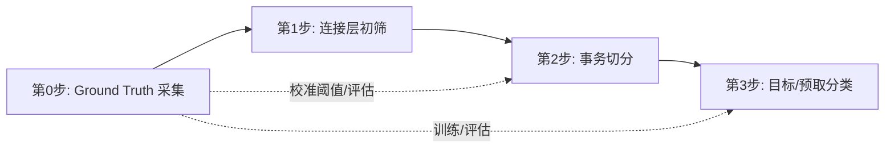

# QUIC 多流复用场景下的视频流分离方案（以 Snapchat 为例）

> 目标：在同一个 QUIC 连接中，将 **目标视频（当前播放）** 与 **预取推荐视频** 的流量进行分离（至少做到初筛）。

---

## 一、问题本质与核心思路

### 1.1 难点

QUIC 的 1-RTT 短包头报文中，**stream ID、帧类型、HTTP/3 头部（`:path`、`range`、`priority`）全部被加密**，并且一个 UDP 包内可以同时携带多个 stream 的 STREAM 帧。被动观察者能获得的信息只有：

| 可见信息 | 用途 |
|---|---|
| 包时间戳、方向、UDP 长度 | 事务切分、尺寸估计 |
| DCID（目的连接 ID） | 连接跟踪（含连接迁移） |
| spin bit（若启用） | RTT 估计 |
| Initial 包（使用公开 salt 保护，可解密） | 获取 SNI / ALPN / 版本，做连接层过滤 |

### 1.2 核心思路

既然无法直接"按 stream 拆"，就把问题转化为两个子问题：

1. **事务重建**：从加密包序列中重建 "请求 → 响应" 事务（transaction），估计每个对象的起止时间与字节数；
2. **事务归属**：判断每个事务是为"当前播放"服务（目标视频），还是"投机性"的预取。

并且用**可解密的 ground truth** 构成闭环：用标注数据确定阈值、训练分类器、评估效果。



---

## 二、具体操作步骤

### 第0步：获取 Ground Truth（强烈建议优先完成）

> ⚠️ 仅在**自有设备、自有账号**上进行研究，遵守应用服务条款与研究伦理。

**环境准备**
- 一台已 root 的 Android 测试机 + `adb` + Frida；
- 抓包端：手机热点/路由器旁路镜像，或设备上 `tcpdump`；
- 工具：Wireshark / tshark（≥ 3.x，支持 QUIC 解密）、Python（pandas、scikit-learn）。

**操作**
1. **导出 TLS 密钥**：使用 Frida hook BoringSSL（或 Cronet 内置）的 keylog 回调，将 secrets 写成 `SSLKEYLOGFILE` 格式；
2. **同步抓包**：`tcpdump -i wlan0 -w cap.pcap udp port 443`；
3. **解密分析**：Wireshark 中 `TLS → (Pre)-Master-Secret log filename` 指向 keylog 文件，即可看到每个 stream 的 HEADERS（URL、Range、priority）与 DATA 字节；
4. **应用层日志（可选）**：hook 网络库请求回调，记录 URL、开始/结束时间、字节数，与 pcap 按时间对齐；
5. **用户行为标注**：`adb shell getevent -lt > touch.log` + 录屏，标注每次滑动（切换视频）的时刻；
6. （辅助手段）阻断 UDP 443 迫使回落 TCP+TLS 后做 MITM，仅用于理解资源/URL 结构，**不能**当作 QUIC 层 ground truth（请求行为可能改变）。

**利用 ground truth 先回答的关键问题**（决定后续启发式是否成立）：

- [ ] 目标视频与预取视频是否真的在**同一连接**？SNI / CDN 域名是否不同？
- [ ] 预取是下载**整个视频**还是**前缀**（`Range: bytes=0-N`）？N 是否固定？
- [ ] 请求是否**并发**？服务器调度是**顺序**还是**交错**（RFC 9218 `priority: u=?, i`）？
- [ ] 预取视频被"提升"为目标后，是否直接命中缓存 / 只请求剩余部分？

---

### 第1步：连接层初筛

1. **提取 SNI**：tshark 可自动解密 Initial 包：
   ```bash
   tshark -r cap.pcap -Y "quic && tls.handshake.type==1" \
          -T fields -e frame.time_epoch -e ip.dst -e udp.dstport \
          -e quic.dcid -e tls.handshake.extensions_server_name
   ```
2. **过滤视频 CDN 连接**，按 DCID / 5 元组跟踪连接（注意连接迁移）；
3. **跨连接旁路信号**：
   - API / 埋点连接上的小上行请求往往与"滑动/观看完成"同步 → 可作为**切换时刻标记**；
   - API 连接上的大下行响应（feed / 推荐列表）往往预示着**随后一批预取**；
   - 以上需用第0步的标注验证其可靠性。

---

### 第2步：事务切分（核心）

#### 2.1 上行请求检测

客户端上行包大致分三类：

| 类型 | 典型大小 | 说明 |
|---|---|---|
| 纯 ACK | 很小 | 最常见 |
| 流控更新 / PRIORITY_UPDATE | 小 | MAX_DATA / MAX_STREAM_DATA 等 |
| HTTP/3 请求 HEADERS | 明显更大 | 含视频 ID、签名 token |

- 用解密数据学习一个**长度阈值**，或训练小分类器，特征：包长、距上一个下行包的间隔、其后约 1 RTT 内是否出现下行突发；
- 坑：QPACK 动态表会使后续请求变小，但视频 ID / token 基本不可压缩，通常仍显著大于 ACK。

#### 2.2 下行响应归属

- **响应开始** ≈ 请求时刻 + RTT（RTT 由握手 Initial↔Handshake 时间差或 spin bit 估计）；
- **响应结束线索**：未满 MTU 的"尾包" + 其后的空闲间隔；或下一个请求的出现；
- **串行情形**：两次请求之间的下行字节 ≈ 对象大小；
- **并发情形**，按服务器调度模型分配：
  - *顺序调度*（non-incremental，按 urgency / stream ID）：字节呈连续块，按请求顺序依次切分；
  - *交错调度*（incremental）：某区间内有 k 个活跃对象时各分 1/k；
  - 可形式化为一个小型约束拟合：已知请求时刻序列、下行累计字节曲线 `C(t)`、候选结束点集合，求使拟合误差最小的各对象大小。
- **局限**：服务器常把下一个 stream 的数据填入同一个包，导致尾包不可见 → 需先用解密数据测量"尾包可见率"。

#### 2.3 示意代码

```python
# 最简版本：串行 + 尾包启发式
for req in uplink_requests:                       # 由长度阈值检测出的请求
    start = req.t + rtt
    end = next_tail_or_gap(downlink, start)       # 未满 MTU 的包 + 空闲间隔 > θ
    obj = Transaction(req.t, start, end, bytes_between(downlink, start, end))
    # 若与其他事务时间区间重叠 → 标记 concurrent，交由调度模型重新分配字节
```

---

### 第3步：事务分类（目标 vs 预取）

#### 3.1 规则初筛

| 特征 | 目标视频 | 预取视频 |
|---|---|---|
| 触发时机 | 紧跟滑动（或滑动标记）之后 | 播放期间空闲期 / feed 刷新之后 |
| 请求形态 | 单个请求 + 后续续传（ON-OFF 补缓冲） | 一批 k 个近乎同时的请求 |
| 对象大小 | 可变，常为整段或剩余部分 | 聚集在固定前缀大小附近 |
| 调度表现 | 先发、速率高 | 被延后 / 与其他请求并发 |
| 后续行为 | 有续传 | 多数无续传，被"提升"时才出现 |

#### 3.2 机器学习精筛

- 模型：GBDT / 随机森林（用第0步标注训练）；
- 特征：距最近滑动标记的时间、同批并发数、批内序号、对象字节数、下载时长、吞吐、之后是否有续传、距上一次 feed 刷新的时间；
- 进阶：序列模型（HMM / CRF），状态 = {目标下载, 预取批次, 空闲}，利用行为的阶段性。

---

## 三、标签定义的注意事项

"目标 / 预取"是**动态**的：预取对象在用户滑过去后就变成目标，并且可能**完全命中缓存而不产生任何流量**。

建议：
- 标签定义在**请求发出时刻的意图**上：(a) 为当前播放发出的请求；(b) 投机性请求；
- 单独统计**预取命中率**，避免评估口径混乱。

---

## 四、受控实验设计

| 实验 | 操作 | 目的 |
|---|---|---|
| 长停留 | 每个视频完整看完再滑 | 预取批次出现在停留期，最易提取预取签名 |
| 快速连滑 | 连续快速滑动 | 耗尽预取缓存，观察目标视频"冷启动"签名 |
| 弱网 | `tc` / 网络模拟器限速、加延迟、丢包 | 观察预取是否被抑制、调度是否变化 |
| 冷/热启动 | 清缓存 vs 不清缓存 | 对比缓存命中对流量的影响 |

**评估指标**
- 请求检测：Precision / Recall；
- 对象大小估计：相对误差；
- 分类：Accuracy / F1，以及**按字节加权**的准确率。

---

## 五、参考文献

- Gutterman et al., *Requet: Real-Time QoE Detection for Encrypted YouTube Traffic*, MMSys 2019 —— 基于上行包大小检测 chunk 请求；
- Mazhar & Shafiq, *Real-time Video Quality of Experience Monitoring for HTTPS and QUIC*, INFOCOM 2018；
- Dashlet: *Taming Swipe Uncertainty for Robust Short Video Streaming*, NSDI 2024 —— 测量了 TikTok 短视频的滑动与预取行为；
- RFC 9000 / 9001（QUIC 传输与 Initial 包保护）、RFC 9204（QPACK）、RFC 9218（HTTP 可扩展优先级）。

---

## 六、后续 TODO

- [ ] 搭建 root 测试机 + Frida keylog 导出环境
- [ ] 采集解密数据集，回答第0步的 4 个关键问题
- [ ] 实现 tshark → pandas 的包级特征提取脚本
- [ ] 实现事务切分（串行版 → 并发调度模型版）
- [ ] 规则初筛 + 分类器训练与评估
