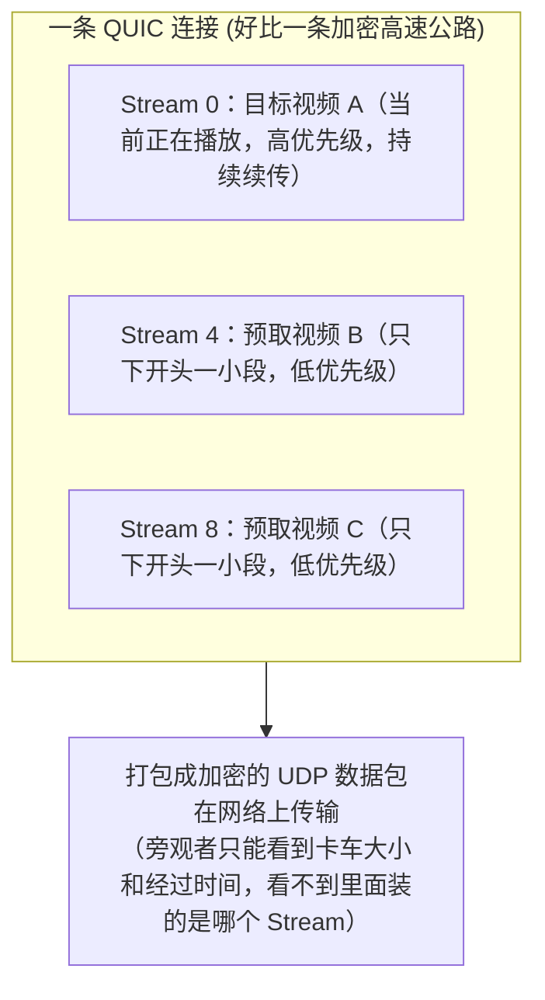
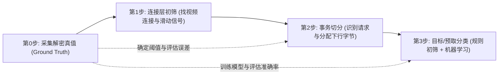

# QUIC 多流复用场景下的视频流分离方案（以 Snapchat 为例）

> **目标**：在同一个 QUIC 连接中，将 **目标视频（当前正在播放的视频）** 与 **预取推荐视频（后台提前缓存的候选视频）** 的网络流量进行分离（至少做到初筛）。  
> **读者友好说明**：本文档在第零部分专门补充了网络流量、短视频传输机制与 QUIC 协议的通俗背景知识；即使你之前没有深入接触过流量分析，也可以顺畅读懂后续方案。

---

## 零、预备知识：从“刷短视频”到“网络数据包”

在进入技术方案前，我们先用最直观的方式把“刷视频时网络上发生了什么”以及“QUIC 为什么难分析”讲清楚。

### 0.1 网络流量与抓包基础

当你用手机刷 Snapchat 时，手机和远端服务器之间在不停地互相寄“快递包裹”，这些包裹就叫 **数据包（Packet）**。

1. **上行（Uplink）与下行（Downlink）**
   - **上行（手机 → 服务器）**：手机发出的包。比如告诉服务器“我要看第 3 个视频”（**请求，Request**），或者“你刚发的第 10 号包裹我收到了”（**确认回执，ACK**）。上行包通常很小、很稀疏。
   - **下行（服务器 → 手机）**：服务器发回来的包，里面装着真正的视频画面和声音数据（**响应，Response**）。看视频时，绝大部分流量（95% 以上）都是下行包。
2. **MTU（最大传输单元）与“满包 / 尾包”**
   - 网络规定单个数据包不能无限大，通常上限在 **1200～1500 字节**左右，这个上限叫 **MTU（Maximum Transmission Unit）**。
   - 如果服务器要发一段 100 KB 的视频数据，它必须切成约 70～80 个装得满满的数据包（每个约 1350 字节，称为**满包**）连续发出来；而最后剩下的零头可能只有几百字节（装不满一个包），这个包就叫**尾包（Tail Packet）**。
   - **为什么这很重要？** 即使数据包被加密了，我们看不见里面写的什么，但只要看到“一连串满包突然变成了一个小尾包，接着安静了一小会儿”，就能猜到：**这一小段视频文件刚刚传完了！**
3. **RTT（往返时延，Round-Trip Time）**
   - 手机发一个包到服务器，服务器再回一个包到手机所花的时间（通常几十毫秒）。手机发出“我要看视频”的上行请求包后，大约要等 **1 个 RTT**，服务器的下行视频包才会像瀑布一样涌过来。
4. **抓包（PCAP 文件）**
   - 用工具（如 Wireshark、`tcpdump`）把经过手机网卡的每个包记录下来，保存成 `.pcap` 文件。就算内容加密，抓包记录里依然能看到每条记录的：**时间戳（几点几分几秒）、方向（上行还是下行）、包长度（多少字节）、源/目的 IP 和端口**。

---

### 0.2 短视频 App 是怎么传视频的？

理解业务逻辑，是做流量分离的关键。短视频 App 不会傻乎乎地一次把整个视频下完，而是有精巧的策略：

1. **分片请求（Chunk / Range 请求）与“续传”**
   - 一个视频假设有 5 MB，但很多用户看 2 秒就划走了。为了省流量，App 会用 HTTP 的 `Range`（范围）功能，比如先请求前 500 KB（`Range: bytes=0-512000`，够播前 3 秒）；
   - 当你停留继续看、播放器缓冲区快见底时，App 再发第二个请求去拉接下来的 500 KB（`Range: bytes=512001-1024000`）。这种“播一点、拉一点、停一下、再拉一点”的节奏，叫做**续传（或 ON-OFF 缓冲模式）**。
2. **目标视频（Target Video） vs 预取视频（Prefetch Video）**
   - **目标视频**：当前停留并显示在屏幕上的视频。App 会优先保障它的下载速度，并且只要你一直看，它就会产生后续的分片续传。
   - **预取视频**：为了让你手指往上滑的瞬间“零等待秒开”，当你正在看第 1 个视频时，App 会在后台偷偷把推荐列表里第 2、3、4 个视频的**开头一小段（前缀）**提前下载好存进本地缓存。
     - 如果你滑到了第 2 个视频，它直接用缓存秒播，并在需要时继续下载剩余部分（此时它“转正”成了目标视频）；
     - 如果你直接关掉 App 或快速连滑跳过了它，那这批预取流量就再也不会有后续了。
3. **两类不同的网络连接：信令（API）连接 vs 媒体（CDN）连接**
   - App 通常会建立多条连接：
     - **信令/API 连接**：连向业务服务器，传输“用户刚刚滑动了屏幕”、“请求刷新下一批推荐视频列表（Feed）”等控制信息，数据量较小；
     - **媒体 CDN 连接**：连向内容分发网络（CDN）服务器，专门用来拉取体积庞大的视频和封面图片。我们要分离的“目标视频 vs 预取视频”，正是挤在这条媒体 CDN 连接里。

---

### 0.3 什么是 QUIC 协议与“多流复用”？

1. **QUIC 与 HTTP/3 是什么？**
   - 传统的网页和视频跑在 `TCP + TLS` 协议上；而 **QUIC** 是基于 `UDP` 的新一代加密传输协议（也是 **HTTP/3** 的底层传输层）。Snapchat、YouTube、Instagram、TikTok 等主流应用已广泛采用 QUIC。
2. **连接（Connection）与流（Stream）——“一条大水管里套着多根小吸管”**
   - **连接（Connection）**：手机和某台 CDN 服务器之间建立的一条加密大管道。
   - **流（Stream）**：在这条大管道内部，可以同时开辟多条虚拟的轻量级小通道，每条小通道叫做一个 **Stream**，并分配一个编号（`Stream ID`，如 Stream 0、Stream 4、Stream 8……）。
   - **多流复用（Stream Multiplexing）**：App 不需要为每个视频新建一条连接，而是直接在同一条 QUIC 连接里：用 `Stream 0` 下载当前的目标视频 A，同时用 `Stream 4`、`Stream 8`、`Stream 12` 预取后面的推荐视频 B、C、D。
3. **包（Packet）与帧（Frame）——“卡车与货箱”**
   - 如果把一个 UDP/QUIC **数据包（Packet）** 比作一辆卡车，那卡车车厢里装的一个个小货箱就叫 **帧（Frame）**：
     - `STREAM 帧`：装着某一个 Stream 的真实数据（比如 HTTP/3 请求头，或视频文件的一部分）；
     - `ACK 帧`：装着收货确认信息；
     - `PRIORITY_UPDATE 帧`：告诉服务器哪个 Stream 更紧急、应该先发谁。
   - **注意**：一辆卡车（同一个 UDP 包）里，完全可以同时混装 `Stream 0` 的货箱和 `Stream 4` 的货箱！



---

### 0.4 为什么旁观者很难直接把它们拆开？（加密边界）

我们可以把 QUIC 数据包想象成**贴着快递面单的密封保险箱**：

- **箱子外面能看到的（明文信息）**：
  1. **五元组、时间戳、方向、包长度**：几点几分、从哪到哪、包有多重（多少字节）；
  2. **DCID（Destination Connection ID，目的连接 ID）**：贴在箱子外的连接编号。哪怕手机从 Wi-Fi 切换到蜂窝网络（IP 地址变了，这叫**连接迁移**），只要看 DCID 就能认出还是原来那条 QUIC 连接；
  3. **Initial 包（建连握手包）**：连接刚建立时的第一批包。虽然也受保护，但加密密钥是由全球公开的固定常数（公开 Salt）算出来的，所以 Wireshark 等工具能**直接自动解密**，从中读出手机想去访问哪个服务器域名——即 **SNI（Server Name Indication，服务器名称指示）**，例如 `*.sc-cdn.net`；
  4. **Spin Bit（旋转位，可选）**：包头外预留的 1 个比特标志位，通信双方每来回一次就翻转一次，可用于被动测算 RTT。
- **箱子里面锁死的（1-RTT 短包头加密区，旁观者完全看不见）**：
  - `Stream ID`（这包数据到底属于哪个视频流？看不见！）
  - 帧类型（这包里是 ACK 还是视频数据？看不见！）
  - HTTP/3 头部（请求的网址 `:path`、请求范围 `Range`、紧急程度 `priority`，统统看不见！）

---

### 0.5 核心术语速查表

在阅读下文时，如果遇到不熟悉的缩写，可以随时翻看此表：

| 术语 / 缩写 | 通俗解释 |
|---|---|
| **事务（Transaction）** | 一次完整的“客户端发一个请求 → 服务器回一段响应数据”的回合（对应下载一个视频或一个视频分片）。 |
| **Ground Truth（真实标注 / 真值）** | 在实验阶段通过解密手段拿到的“标准答案”（清楚知道每个包属于哪个视频、是目标还是预取），用来检验我们盲猜得准不准。 |
| **SNI（服务器名称指示）** | 握手时客户端亮出的目标网站域名（如 `bolt-gcdn.sc-cdn.net`），用于区分哪条连接是拉视频的、哪条是传普通信令的。 |
| **ALPN（应用层协议协商）** | 握手时协商使用的应用协议名称（比如 `h3` 代表 HTTP/3）。 |
| **QPACK** | HTTP/3 专用的请求头压缩算法。它会把重复出现的头部字段用短编号代替，导致后面的请求包体积变小。 |
| **SSLKEYLOGFILE** | 一种标准格式的文本文件，记录了 TLS/QUIC 会话的对称加密密钥。把它导入 Wireshark 就能把密文包完全解密成明文。 |
| **Frida** | 一款常用的动态插桩工具，可以在已获取 root 权限的测试手机上，把 App 内存里的加密密钥实时提取出来。 |
| **GBDT / 随机森林 / HMM / CRF** | 常用的机器学习与序列分类算法。把我们提取出的流量特征（如包大小、时间间隔）喂给它们，就能自动判断“目标 vs 预取”。 |

---

## 一、问题本质与核心思路

### 1.1 难点总结

有了上面的背景知识，难点就非常清晰了：在正式传输视频的 **1-RTT 短包头报文**中，`Stream ID`、帧类型、HTTP/3 头部全部被加密，且单个 UDP 包可能混装多个 Stream 的帧。被动观察者（在没有密钥的情况下）能拿到的只有：

| 可见信息 | 在本方案中的用途 |
|---|---|
| 包时间戳、方向（上/下行）、UDP 长度 | 识别上行请求、切分下行视频分片、估计对象字节数 |
| DCID（目的连接 ID） | 跨网络跟踪同一条 QUIC 连接 |
| Spin Bit（若开启）或握手包时间差 | 估计网络往返时间 RTT |
| Initial 握手包（可用公开 salt 自动解密） | 提取 SNI 域名，从众多连接中筛选出视频 CDN 连接 |

### 1.2 核心思路：把“按流拆分”转化为“事务重建 + 意图分类”

既然看不到 `Stream ID`，无法从协议字段上直接按流拆开，我们就退一步，采用**行为侧信道（Traffic Behavior Side-Channel）**的思路，把问题拆成两步走：

1. **第一步：事务重建（切分出一个个视频分片请求与响应）**  
   虽然包是加密的，但“手机先发一个较大的上行包（请求），约 1 个 RTT 后服务器连续发回一大波下行包（视频数据）”这种一问一答的骨架是藏不住的。我们先从连续的包序列里，把每一次“请求 → 响应”的边界切分出来，称为一个**事务（Transaction）**。
2. **第二步：事务归属（区分哪个事务是目标视频，哪个是预取）**  
   切出事务后，利用两者的**业务逻辑差异**来分类：
   - **目标视频**：紧跟在用户“手指滑动”之后发生，往往单独发起、下载量大或有持续的后续分段请求（续传）；
   - **预取视频**：常在用户安静观看期间或推荐列表刷新后，**成批（一瞬间连发几个请求）**出现，且每个只下载固定大小的开头前缀（如几百 KB），绝大多数不会有后续续传。

同时，我们在自己的测试机上通过**导出密钥解密（获取 Ground Truth 标准答案）**，用来校准切分阈值、训练分类模型，并量化初筛的准确率。



---

## 二、具体操作步骤

### 第0步：获取 Ground Truth 真值数据（强烈建议最先做）

> ⚠️ **合规提示**：请仅在**自己拥有的测试手机、自己的测试账号**上进行实验抓包，用于学术与技术研究。

为什么这一步必不可少？如果完全不看解密后的真实内容，你写出来的切分规则到底准不准、Snapchat 的预取到底长什么样，全都只能靠猜。先在测试机上拿一小批“既抓了包、又导出了密钥能解密”的数据，就能把应用底层的脾气摸透。

#### 0.1 环境准备
- 一台已获取 root 权限的 Android 测试手机，电脑安装好 `adb` 和 `Frida`；
- 抓包方式：手机上直接运行 `tcpdump`，或者电脑开热点让手机连上来抓包；
- 分析工具：Wireshark / `tshark`（版本 ≥ 3.6，支持 QUIC 与 HTTP/3 解密）、Python（`pandas`、`scikit-learn`）。

#### 0.2 具体操作
1. **导出 TLS/QUIC 密钥**：用 Frida 挂载（hook）Snapchat 底层网络库（如 BoringSSL / Cronet）的密钥生成函数，把密钥实时写成标准的 `sslkey.log`（即 `SSLKEYLOGFILE` 格式）；
2. **同步抓包**：在手机或网关运行命令抓取 UDP 443 端口流量：
   ```bash
   tcpdump -i wlan0 -w cap.pcap udp port 443
   ```
3. **在 Wireshark 中解密查看真值**：打开 `Edit → Preferences → Protocols → TLS`，在 `(Pre)-Master-Secret log filename` 中填入刚刚导出的 `sslkey.log`。此时原本黑盒的 QUIC 包就会完全展开，你能直接看到每个 `Stream ID`、HTTP/3 的请求网址 `:path`、`Range` 范围、优先级 `priority` 以及真实字节数；
4. **记录屏幕滑动时刻（辅助对齐）**：通过 `adb shell getevent -lt > touch.log` 记录手指触摸屏幕的时间，或同步录屏，标出每次“切换到下一个视频”的准确秒数；
5. **（可选备选方案）禁掉 UDP 迫使降级到 TCP**：如果在个别环境下实在提取不到 QUIC 密钥，可以在路由器防火墙把 UDP 443 端口封掉，迫使 App 降级使用传统的 `TCP + TLS (HTTPS)`，再用常规抓包工具（如 Mitmproxy / Charles 配合系统证书）查看明文请求。但要注意：降级到 TCP 后，App 的并发和预取策略可能会发生轻微改变，因此它适合用来了解 URL 结构，不能 100% 等同于 QUIC 下的真实调度表现。

#### 0.3 用真值数据优先回答 4 个关键问题
拿到解密数据后，先用肉眼或简单脚本确认以下 4 件事（答案直接决定第 2、3 步用哪套规则最有效）：

- [ ] **问题 1：目标视频和预取视频真的在同一条 QUIC 连接里吗？**  
  有的应用会把预取请求发往另一个专门的二级域名或另一条连接。如果域名（SNI）不同，我们在第 1 步直接按连接就能 100% 分开！如果确实混在同一条连接里，再往下走。
- [ ] **问题 2：预取视频每次下载多大？是固定前缀吗？**  
  看解密出来的 HTTP/3 请求头里有没有 `range: bytes=0-N`。很多短视频 App 预取时永远只拉前 `N` 字节（例如前 256 KB 或 512 KB）。如果 `N` 很固定，“响应大小落在 `N` 附近”就会成为识别预取的强力特征。
- [ ] **问题 3：多个请求同时发出时，服务器是怎么发数据的？**  
  当 1 个目标视频和 3 个预取视频的请求同时在连接里时，服务器是**严格排好队一个发完再发下一个（顺序调度）**，还是**你一包我一包地交替发（交错调度）**？可以顺便查看 HTTP/3 头部里的 `priority: u=?, i`（RFC 9218 优先级字段，`u` 越小越紧急，`i` 代表是否交错）。
- [ ] **问题 4：预取过的视频被用户滑到时，还会产生流量吗？**  
  当用户滑到第 2 个视频时，如果该视频本身很短、在预取阶段就已经被整个下完了，那么滑过去时**本地直接读缓存，网络上不会产生任何媒体请求**；如果只预取了前 300 KB，滑过去后就会看到一条从 `bytes=300001-...` 开始的续传请求。

---

### 第1步：连接层初筛（从杂乱流量中拎出视频连接与外部信号）

在没有密钥的纯黑盒抓包文件（`cap.pcap`）上，按以下步骤做第一道筛选：

1. **自动解密 Initial 包，按域名（SNI）挑出视频 CDN 连接**  
   前面讲过，QUIC 刚建连时的 Initial 包无需导出密钥即可被 `tshark` 自动解开。运行以下命令即可导出每条连接访问的服务器域名：
   ```bash
   tshark -r cap.pcap -Y "quic && tls.handshake.type==1" \
          -T fields -e frame.time_epoch -e ip.dst -e udp.dstport \
          -e quic.dcid -e tls.handshake.extensions_server_name
   ```
   从中只保留域名属于 Snapchat 视频 CDN（如 `*.sc-cdn.net` 等媒体域名）的连接，过滤掉广告、日志、普通网页等无关流量。后续通过五元组或 `quic.dcid` 跟踪这条连接上的所有上下行包。

2. **利用其他连接上的“旁路信号”标记用户行为**  
   虽然视频连接内部是加密的，但手机同时还连着 Snapchat 的**业务 API / 埋点服务器**。根据经验与实验观察：
   - **滑动切换标记**：每当用户手指一滑切换到下一个视频，App 往往会立刻在 API/统计连接上发出一两个很小的上行包（汇报观看时长或请求上下文信息）。这些小包出现的时间点，就是极佳的**“疑似切换视频时刻”**；
   - **推荐列表（Feed）刷新标记**：当 API 连接上突然收到一个几 KB 到几十 KB 的下行响应（下发新一批推荐视频列表 JSON）时，紧接着的几百毫秒内，视频 CDN 连接上大概率会爆发**一整批预取请求**。

---

### 第2步：事务切分（核心步骤：在加密流中还原“一问一答”）

现在我们聚焦在某一条视频 CDN 的 QUIC 连接上。面对一长串只有“时间、方向、包大小”的上下行包序列，怎么把每个视频（或视频分片）切分出来？

#### 2.1 第一小步：从上行包里揪出“视频请求（Request）”

在这条视频连接上，手机发给服务器的上行包其实只有三种可能：

| 上行包类型 | 典型包大小（UDP 载荷） | 物理含义与特征 |
|---|---|---|
| **纯 ACK 包** | 很小（通常 < 100 字节） | 只是告诉服务器“刚才的视频包收到了”，数量最多，密集出现在下行包期间 |
| **流控 / 优先级更新** | 较小（约几十～100多字节） | 告诉服务器“我缓冲区还有空位（`MAX_DATA`）”或调整流优先级 |
| **HTTP/3 视频请求包** | **明显偏大（通常 > 200～500 字节）** | 里面装着 `HEADERS` 帧，包含长长的视频 URL 路径、视频 ID、防盗链签名 Token |

- **怎么识别？**  
  利用第 0 步的真值数据，画一下“真实请求包”和“普通 ACK 包”的长度分布图，就能直接定出一个**包长度阈值**（例如 `UDP 长度 > 250 字节` 的上行包记为一次请求）；或者结合“发包后约 1 个 RTT 内是否立刻引发了一波下行大包”来联合判断，准确率通常非常高。
- **需要注意的小细节（QPACK 压缩）**：  
  同一条连接里的第 1 个请求包通常最大；从第 2 个请求开始，由于 HTTP/3 的 QPACK 算法复用了相同的请求头字段（如 `Host`、`User-Agent`），包体积会缩水一截。但因为每个视频的 ID 和签名 Token 都是独一无二的随机长字符串（无法被压缩），所以请求包依然会显著大于纯 ACK 包。

#### 2.2 第二小步：把下行视频数据包分配给对应的请求

找出了所有上行请求发出的时间点 $t_1, t_2, \dots, t_n$ 后，接下来要把服务器发来的下行字节归属到每个请求头上：

- **确定响应开始时间**：请求发出后，大约经过 `1 个 RTT`，对应的下行视频数据开始到达（RTT 可由握手阶段 Initial 包与 Handshake 包的时间差算出）。
- **情况 A：请求是“串行”的（上一个视频下完了，才发下一个请求）**  
  这是最简单的情况！两次上行请求之间的所有下行数据包字节加起来，就是前一个请求对应的视频分片大小；而该分片的结束时刻，往往伴随着一个**未装满 MTU 的“尾包”**以及随后的一段空闲期（没有下行包）。
- **情况 B：请求是“并发”的（一瞬间连发了多个请求，下行包混在一起）**  
  比如 App 在 10 毫秒内连续发出了 3 个请求，随后服务器连绵不断地发了 1.5 MB 的下行数据才停下来。怎么知道这 3 个对象各自占多少字节？这取决于第 0 步观察到的**服务器调度模式**：
  1. **顺序调度（Non-incremental，最常见）**：服务器虽然同时收到了 3 个请求，但它按优先级或先来后到，**先把第 1 个视频发完，再发第 2 个，最后发第 3 个**。此时总字节数是三者之和，我们可以尝试在中间寻找夹杂的“尾包”或微小的速率顿挫点来切分；如果中间尾包被合包掩盖了，也可以先将整段标记为一个“并发批次（Batch）”，按批次平均估计或结合后续特征处理。
  2. **交错调度（Incremental）**：如果服务器在同一时间段内对 $k$ 个活跃流轮流发包，则在重叠的时间窗口内，可以把下行流量按 $1/k$（或按优先级权重）分摊给当前活跃的请求。

#### 2.3 事务切分的极简代码逻辑示意

```python
# 伪代码示意：从单条 QUIC 视频连接的包序列中切分“请求 -> 响应”事务
# 输入：packets（按时间排序的包列表，含 timestamp, direction, length）
# 参数：REQ_LEN_THRESH（上行请求包长度阈值，如 250 字节）
#       MTU_TAIL_THRESH（满包阈值，如 1200 字节）
#       IDLE_GAP_THRESH（空闲间隔阈值，如 0.05 秒）

uplink_requests = [
    p for p in packets
    if p.direction == "uplink" and p.length >= REQ_LEN_THRESH
]

transactions = []
for i, req in enumerate(uplink_requests):
    resp_start = req.timestamp + rtt_estimate
    # 先看距离下一个上行请求有多远，判断是否与其他请求并发重叠
    next_req_time = uplink_requests[i + 1].timestamp if i + 1 < len(uplink_requests) else float("inf")

    # 在下行包中寻找当前响应的结束点（未满 MTU 的尾包 + 空闲间隔）
    resp_end, down_bytes = find_response_end_and_bytes(
        packets, start_time=resp_start, max_Gap=IDLE_GAP_THRESH, mtu=MTU_TAIL_THRESH
    )

    is_concurrent = (next_req_time < resp_end)
    transactions.append({
        "req_time": req.timestamp,
        "req_size": req.length,
        "resp_start": resp_start,
        "resp_end": resp_end,
        "down_bytes": down_bytes,
        "is_concurrent": is_concurrent,  # 若为 True，后续交由并发批次模型细分
    })
```

---

### 第3步：事务分类（初筛与精筛：谁是目标视频，谁是预取？）

经过第 2 步，我们已经把杂乱的数据包变成了整齐的“事务表格”（每行代表一次视频/分片下载，记录了发起时间、是否并发、下载字节数、耗时等）。现在就可以区分**目标视频**和**预取视频**了。

#### 3.1 第一层：基于业务规律的“规则初筛”（无需训练模型即可动手）

目标视频和预取视频在行为模式上有非常鲜明的对比：

| 对比维度 | 目标视频（当前播放） | 预取推荐视频（后台提前缓存） |
|---|---|---|
| **1. 触发时机** | 紧跟在**用户滑动屏幕**（或 API 连接出现滑动信令）之后立即发起 | 出现在用户安静看视频的中途空闲期，或紧跟在 **Feed 推荐列表刷新**之后 |
| **2. 并发形态** | 往往是**单枪匹马（1 个独立请求）**率先发出 | 往往是**成群结队（Batch）**出现——几十毫秒内连续发出 $k$ 个（如 2～5 个）请求 |
| **3. 下载大小** | 大小不固定（取决于视频总长或剩余未播部分），通常较大 | 高度聚集在某个**固定的前缀大小**附近（如集中在 200 KB～500 KB 区间） |
| **4. 传输优先级** | 服务器优先全速发送，瞬时吞吐率高 | 排在目标视频之后发送，或几个预取流之间互相抢带宽 |
| **5. 后续是否有“续传”** | 只要用户多看几秒，几秒后会再次出现同模式的**后续分片请求** | **绝大多数是“一锤子买卖”**，下完前缀就没动静了（除非用户后来真的滑到了它） |

> **极简初筛规则示例**：  
> - 如果某次请求距离“滑动标记”很近（如 `< 300 ms`），且单独发起（或排在并发批次的第 1 个），随后几秒内还有续传请求 → **优先判定为【目标视频】**；  
> - 如果在极短时间内（如 `< 100 ms`）连续冒出 $\ge 2$ 个请求，或者在推荐列表刷新后立即成批出现，且单个事务下载量恰好落在固定前缀大小附近、后续无续传 → **优先判定为【预取视频】**。

#### 3.2 第二层：基于机器学习的“精筛”

当拿到第 0 步的标注数据后，可以把上述直觉转化为特征，训练一个轻量级分类器（如 **随机森林 Random Forest** 或 **梯度提升树 GBDT / LightGBM**）：

- **输入特征（Features）**：
  1. `time_since_last_swipe`：距离最近一次滑动信令的时间差；
  2. `batch_size` 与 `rank_in_batch`：当前请求所在突发批次的请求总数（1 代表独立请求，>1 代表批量请求），以及它在该批次里排第几；
  3. `inter_req_time_prev` / `inter_req_time_next`：与前一个、后一个上行请求的时间间隔；
  4. `down_bytes`、`duration`、`throughput`：本次事务估计的下行字节数、持续时长、平均速率；
  5. `has_followup_within_T`：未来 $T$ 秒内（且在下次滑动前）是否还有新的请求发生；
  6. `time_since_feed_refresh`：距离上一次 API 连接大响应的时间差。
- **序列模型进阶（HMM / CRF）**：  
  因为刷视频的过程具有很强的状态转移规律（例如总是遵循：`[滑动 → 目标视频首段 → 批量预取 → 目标视频续传 → 空闲 → 下一次滑动]` 的循环），使用隐马尔可夫模型（HMM）或条件随机场（CRF）对一整串事务做联合序列标注，效果往往比孤立地判断单个事务更好。

---

## 三、做实验与打标签时的“避坑指南”

在动手实验时，有几个概念非常容易混淆，提前理清能省去大量返工：

1. **“预取”变“目标”的身份转换问题**  
   - **现象**：视频 B 在第 5 秒时被 App 作为“预取视频”提前下载了前 300 KB；到了第 12 秒，用户手指一滑，开始看视频 B 了！此时如果视频 B 总共只有 280 KB，它已经全在本地缓存里了，第 12 秒网络上**根本不会产生任何下载视频 B 的流量**；如果视频 B 有 1 MB，第 12 秒网络上就会产生一条下载剩余 700 KB 的请求。
   - **怎么定义标签才不会乱？**  
     切勿按“这个视频最终有没有被用户看到”来给历史流量打标签！**必须按“请求发出的那一刻，App 的意图是什么”来打标签**：
     - 第 5 秒发出的那 300 KB 请求，在发出时刻是为了未雨绸缪，所以标签永远是 **【预取（Prefetch）】**；
     - 第 12 秒滑过去后新发出的那 700 KB 续传请求，在发出时刻是为了服务当前屏幕播放，所以标签是 **【目标（Target）】**。
2. **清理缓存与冷/热启动问题**  
   做采集实验前，如果不清空 App 缓存，你会发现滑了好几个视频，网络上却几乎没有视频流量（因为全命中以前存下来的本地缓存了）。因此实验时要么每次通过命令清理缓存目录，要么专门记录并剔除“纯缓存命中”的会话。

---

## 四、循序渐进的受控实验设计

不要一上来就做复杂的随机乱刷实验，建议按从易到难的顺序做 4 组受控实验：

| 实验阶段 | 你的操作方式 | 流量会呈现出什么特点（实验目的） |
|---|---|---|
| **实验 1：长停留慢滑** | 每个视频都耐心看 15～20 秒再滑下一个 | 目标视频的下载和预取批次在时间上拉得很开，互不干扰，最容易看清两者的独立特征 |
| **实验 2：快速连续狂滑** | 每隔 0.5～1 秒就快速往上滑一次 | 预取缓存根本来不及下完就被迫切换，能清晰观察到目标视频“0 缓存冷启动”时的请求特征 |
| **实验 3：弱网限速测试** | 用工具将手机网速限制在 1～2 Mbps 或增加延迟 | 观察带宽不够用时，App 会不会主动减少或停止预取，优先保住目标视频 |
| **实验 4：正常自然使用** | 模拟真实用户随机看几秒或十几秒 | 用作最终测试集，检验初筛规则和分类器在真实混合场景下的表现 |

**怎么衡量你的方案效果好不好？（评估指标）**
- **请求检测准确率（Precision / Recall）**：你的上行包阈值找到了多少个真正的视频请求？有没有把普通控制包误判成请求？
- **字节数估计误差**：你切分出来的每个事务大小，和解密看到的真实 Stream 字节数相比，相对误差是多少？
- **分类 F1 分数与“按字节加权准确率”**：不仅要看分对了多少个事务，还要看**分对了多少比例的流量字节**（因为大流量的主视频分对往往比几 KB 的小碎片分对更重要）。

---

## 五、相关参考文献（延伸阅读）

如果你想了解学术界是怎么处理这类加密视频流量分析的，可以参考以下经典工作：

1. **Requet**（Gutterman et al., *MMSys 2019*, "Requet: Real-Time QoE Detection for Encrypted YouTube Traffic"）：经典论文，详细讲了如何利用加密流量中的**上行请求包 + 下行突发（Chunk Detection）**来还原视频分片并推断播放状态。
2. **Mazhar & Shafiq**（*INFOCOM 2018*, "Real-time Video Quality of Experience Monitoring for HTTPS and QUIC"）：较早在 QUIC 加密流量上做视频分片特征提取与体验推断的工作。
3. **Dashlet**（*NSDI 2024*, "Taming Swipe Uncertainty for Robust Short Video Streaming"）：专门研究短视频（如 TikTok）滑动不确定性与预取缓冲策略的顶会论文，对理解短视频预取机制非常有帮助。
4. **相关协议标准文档**：
   - **RFC 9000 / RFC 9001**：QUIC 传输协议标准与 TLS 加密保护（含 Initial 包公开 Salt 说明）；
   - **RFC 9204**：QPACK（HTTP/3 头部压缩机制）；
   - **RFC 9218**：HTTP 可扩展优先级（Extensible Prioritization Scheme，定义了 `u=` 紧急度与 `i` 交错传输标志）。

---

## 六、落地执行检查清单（TODO）

- [ ] **第 1 阶段（摸底）**：在测试机上跑通 Frida 导出 `SSLKEYLOGFILE` + Wireshark 解密 QUIC，采集 5～10 次滑动会话，回答【第 0.3 节】的 4 个关键问题；
- [ ] **第 2 阶段（提取）**：编写 `tshark` 导出脚本，把 PCAP 转成包含（时间戳、方向、包长、DCID、SNI）的 CSV 表格；
- [ ] **第 3 阶段（切分）**：用 Python 实现【第 2 步】的上行请求检测与下行响应字节切分，对比解密真值计算切分误差；
- [ ] **第 4 阶段（分类）**：先写【第 3.1 节】的简单规则跑出第一版初筛结果，再提取特征训练随机森林 / GBDT 模型完成精筛评估。
